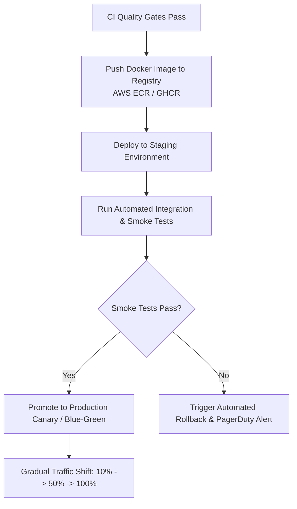

# CI/CD Pipeline Architecture & Notes: Ella API

**Target Workflow:** `.github/workflows/ci.yml`  
**Platform:** GitHub Actions  
**Engine:** Node.js 20.x, Docker Buildx, PostgreSQL 16  

---

## 1. Overview & Quality Gate Architecture

The CI pipeline implements a **fail-fast**, multi-stage verification strategy. Every code push and pull request targeted at `main`, `master`, or `develop` must clear all automated quality gates before code can be merged or deployed.

```
+---------------------------------------------------------------------------------+
|                       Trigger: push / pull_request                              |
+---------------------------------------+-----------------------------------------+
                                        |
       +--------------------------------+--------------------------------+
       |                                |                                |
       v                                v                                v
+--------------+               +------------------+             +-----------------+
| Job 1: Lint  |               | Job 2: Build     |             | Job 3: Unit Test|
| ESLint Check |               | NestJS TypeScript|             | Jest Coverage   |
+-------+------+               +--------+---------+             +--------+--------+
        |                               |                                |
        +-------------------------------+--------------------------------+
                                        |
                                        v
                       +----------------------------------+
                       | Job 4: Docker Build Verification |
                       | Multi-stage Dockerfile Validation|
                       +----------------+-----------------+
                                        | (On merge to main)
                                        v
                       +----------------------------------+
                       | Job 5: CD Staging Deployment Gate|
                       | Container Registry & ECS Rollout |
                       +----------------------------------+
```

---

## 2. Pipeline Stages & Failure Conditions

### 2.1 Job 1: Code Quality & Linting (`lint-and-validate`)
- **Execution**: Installs dependencies with `npm ci --legacy-peer-deps` (cached via `actions/setup-node`) and executes `npm run lint`.
- **Failure Condition**: Any syntax violation, unused imports, or TypeScript typing rule violations immediately fail the workflow.

### 2.2 Job 2: Compilation & Build (`build`)
- **Execution**: Runs `npm run build` using the Nest CLI and checks for the generated binary output at `dist/src/main.js`.
- **Failure Condition**: Any TypeScript compilation error (such as previous `TS2352` cast error) terminates the build immediately.

### 2.3 Job 3: Automated Unit Testing (`unit-tests`)
- **Execution**: Runs `npm test -- --coverage --ci --colors` across all domain services (`Users`, `Products`, `Transactions`).
- **Artifact Archival**: Generates and uploads code coverage reports (`coverage/`) retained for 7 days.
- **Failure Condition**: Any failing assertion or unhandled rejection results in pipeline termination.

### 2.4 Job 4: Container Build Verification (`docker-build-verification`)
- **Execution**: Runs `docker/build-push-action@v5` with GitHub Actions cache backend (`type=gha`) to ensure the production `Dockerfile` builds cleanly without missing build contexts.
- **Failure Condition**: Missing files in build context or broken multi-stage layers fail this stage.

---

## 3. Extending Toward Continuous Deployment (CD)

To transition from Continuous Integration to **Continuous Delivery / Continuous Deployment (CD)**, the pipeline is architected to incorporate the following extensions:



### 3.1 Secure Authentication with Cloud Providers (OIDC)
Rather than storing static long-lived cloud credentials (`AWS_ACCESS_KEY_ID`), configure **OpenID Connect (OIDC)** between GitHub Actions and AWS/GCP:
```yaml
permissions:
  id-token: write
  contents: read

steps:
  - name: Configure AWS Credentials via OIDC
    uses: aws-actions/configure-aws-credentials@v4
    with:
      role-to-assume: arn:aws:iam::123456789012:role/GitHubActionsDeploymentRole
      aws-region: us-east-1
```

### 3.2 Immutable Container Versioning
Images should be tagged immutably using the Git commit SHA and semantic version tag:
```bash
IMAGE_TAG=${{ github.sha }}
docker tag ella-api:latest $ECR_REGISTRY/ella-api:$IMAGE_TAG
docker push $ECR_REGISTRY/ella-api:$IMAGE_TAG
```

### 3.3 Blue-Green & Canary Zero-Downtime Rollout
1. **Staging Auto-Deploy**: Automatically update the staging cluster (e.g. AWS ECS task definition or Kubernetes deployment).
2. **Post-Deployment Smoke Test**: Execute `npm run test:api` against `https://staging-api.ella.internal`.
3. **Production Canary**:
   - Route 10% of user traffic to the new container revision via AWS Application Load Balancer.
   - Monitor error rates, latency (p95), and CPU metrics via CloudWatch alarms for 10 minutes.
   - If error rate remains below 0.1%, automatically scale to 100%. If an alarm triggers, rollback immediately.

