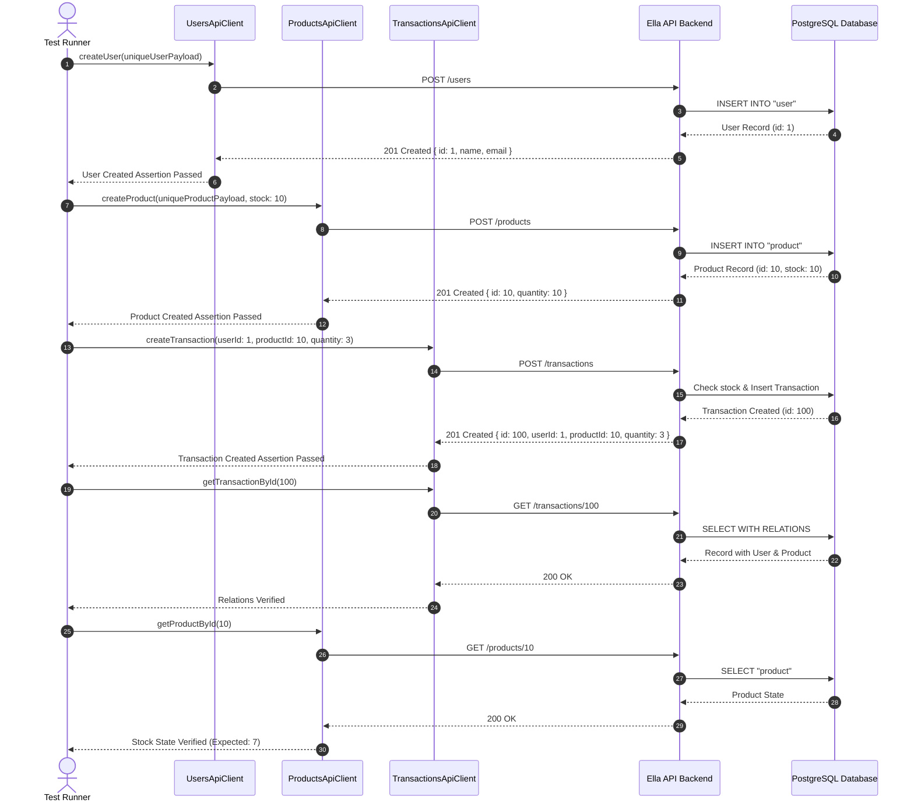

- [ ] Test Automation Architecture Specification: Ella API

This document presents the architectural design, abstraction patterns, and operational principles governing the automated testing framework for the Ella E-Commerce Backend.

---

## 1. Architectural Goals & Design Principles

The automation framework was engineered to achieve four core architectural pillars:

1. **Maintainability & DRY Principles**: Separation of concerns between **Test Logic** (what we test) and **Transport Mechanism** (how we send HTTP requests). Endpoints, routes, and headers are defined strictly once in client modules.
2. **Deterministic Execution & Zero Flakiness**: No static, hardcoded fixtures (e.g. `test@example.com`). The framework utilizes a dynamic `DataFactory` with monotonic counters and epoch timestamps to guarantee collision-free entities across parallel runs.
3. **Environment Agnostic**: The framework operates equally against in-memory NestJS test servers, local Docker containers, ephemeral Kubernetes review apps, and remote staging clusters via dynamic configuration injection (`API_BASE_URL`).
4. **Actionable Failure Diagnostics**: Structured assertion failures with descriptive failure messages, response body dumps, and status verification.

---

## 2. High-Level Component Architecture

```
+-------------------------------------------------------------------------+
|                              Test Suites                                |
|  - e2e-user-flow.spec.ts                                                |
|  - users.api.spec.ts                                                    |
|  - products.api.spec.ts                                                 |
|  - transactions.api.spec.ts                                             |
+------------------------------------+------------------------------------+
                                     |
                                     v
+------------------------------------+------------------------------------+
|                         API Client Layer                                |
|  - UsersApiClient        - ProductsApiClient                            |
|  - TransactionsApiClient - HealthApiClient                              |
+------------------------------------+------------------------------------+
                                     |
                                     v
+------------------------------------+------------------------------------+
|                        Base Client Engine                               |
|  - BaseApiClient (Supertest / HTTP Request Engine)                      |
|  - Headers, Authentication Token Interceptors, JSON Serialization       |
+------------------+----------------------------------+-------------------+
                   |                                  |
                   v                                  v
+------------------+---------------+  +---------------+-------------------+
|      Data Generation Layer       |  |       Configuration Layer         |
|  - DataFactory (Unique entities) |  |  - testConfig (BaseURL, Timeouts) |
+----------------------------------+  +-----------------------------------+
```

---

## 3. Layer Breakdown

### Layer 1: Configuration (`src/config/test-config.ts`)
- Evaluates environment variables with robust fallback defaults.
- Allows seamless switching between local Docker, ephemeral CI runners, and staging.

### Layer 2: Core Transport Client (`src/api-clients/BaseApiClient.ts`)
- Wraps Supertest `Test` execution.
- Injects standard HTTP headers (`Accept: application/json`, `Content-Type: application/json`).
- Standardizes response signatures and error handling.

### Layer 3: Domain Service Clients (`src/api-clients/*ApiClient.ts`)
- Implements domain-specific methods mirroring the REST API contract.
- Encapsulates URL path resolution (e.g., `/products/:id`, `/transactions`).
- Types payloads and response contracts using TypeScript interfaces.

### Layer 4: Fixtures & Data Factory (`src/fixtures/data-factory.ts`)
- Generates valid default DTO payloads with overrides.
- Implements collision resistance:
  - Users: `test_user_<timestamp>_<counter>@ella-test.internal`
  - Products: `Product <timestamp>_<counter>`
- Exposes boundary helpers (negative quantities, extreme prices, empty strings).

### Layer 5: Test Execution Specs (`tests/*.spec.ts`)
- Formatted following the **Arrange-Act-Assert (AAA)** paradigm.
- Clear specification titles highlighting business intent and boundary conditions.

---

## 4. End-to-End User Flow Sequence



---

## 5. Scaling the Framework in CI/CD

- **Test Partitioning**: As test suites expand to hundreds of cases, tests can be sharded across parallel CI runners using Jest's `--shard=1/4` flag.
- **Reporting**: Compatible with Jest JUnit and Allure reporters to generate interactive visual test reports directly in GitHub Actions summaries.
- **Contract Testing Integration**: The API clients serve as the ideal baseline for Pact or Prism contract testing against frontend consumers.

