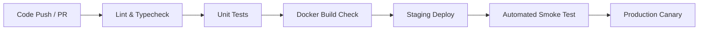

# Quality Assurance & Test Strategy: Ella API

**Document Version:** 1.0  
**Target System:** Ella E-Commerce Backend API (NestJS / PostgreSQL)  
**Author:** QA & DevOps Engineering  

---

## 1. Executive Summary & Objectives

The Ella API provides core backend services powering an e-commerce platform, managing **Users**, **Products** (inventory and pricing), and **Transactions** (order fulfillment). 

The primary mission of this Test Strategy is to establish a rigorous, automated, and repeatable quality assurance process that ensures:
1. **Functional Correctness**: Zero defect leakage in business-critical order processing, payment/transaction records, and inventory accounting.
2. **Data Integrity & Concurrency**: Protection against race conditions, duplicate purchases, overselling, and inventory drift.
3. **High Reliability & Performance**: Sub-200ms API response latency under expected load with high availability (99.9% uptime).
4. **Fast, Safe Deployment Cycles**: Fully automated CI/CD quality gates enabling rapid, confident production releases without downtime.

---

## 2. Test Levels & The Test Pyramid

To optimize feedback velocity and test execution costs, testing is structured across four primary levels:

```
                  / \
                 / E2E \          (End-to-End User Flows: 5-10%)
                /-------\
               /   API   \        (Component & Integration: 25-30%)
              /-----------\
             /     Unit    \      (Services, Business Logic: 60-70%)
            /---------------\
```

### 2.1 Unit Testing
- **Scope**: Individual services, controllers, DTO validation pipes, and custom decorators in isolation.
- **Tools**: Jest, `@nestjs/testing`, `ts-jest`.
- **Approach**: Mock external dependencies (TypeORM repositories, external APIs). Verify branch logic, error raising (`NotFoundException`, `ConflictException`), calculation logic (discounting, inventory deltas), and parameter sanitization.
- **Coverage Target**: Minimum 85% statement and branch coverage on domain services.

### 2.2 API & Integration Testing
- **Scope**: Interaction between NestJS controllers, services, database queries, and PostgreSQL constraints.
- **Tools**: Supertest, Jest, PostgreSQL container.
- **Approach**: Execute actual HTTP requests against real endpoints. Validate status codes, response headers, JSON payload structure, database persistence, and unique constraint handling.

### 2.3 End-to-End (E2E) Critical Flow Testing
- **Scope**: Complete customer journeys across multiple domains.
- **Key Flow**: `User Registration -> Catalog Browsing -> Inventory Verification -> Order Creation (Transaction) -> Stock Deduction Verification`.
- **Approach**: Validates cross-table consistency, foreign key relationships, and distributed state changes across the entire lifecycle.

### 2.4 Performance & Load Testing
- **Scope**: Critical path endpoints (`POST /transactions`, `GET /products`, `GET /products/:id`).
- **Tools**: k6 (scriptable in JavaScript/Go engine).
- **Target Metrics**: 
  - Throughput: $\ge 150\text{ RPS}$ baseline
  - Latency: $p95 < 200\text{ ms}$, $p99 < 500\text{ ms}$
  - HTTP Failure Rate: $< 0.1\%$ under steady-state load

### 2.5 Exploratory & Security Testing
- **Scope**: OWASP API Security Top 10 vulnerabilities.
- **Focus Areas**:
  - Concurrency/race conditions on stock deduction (double spending).
  - Parameter tampering (negative price, fractional quantities, negative stock).
  - SQL injection and ORM bypass attempts.
  - Resource exhaustion via large payload injection.

---

## 3. Tooling Ecosystem & Rationale

| Layer | Tool Chosen | Justification / Rationale |
|---|---|---|
| **Test Runner & Framework** | Jest + TypeScript | Native integration with NestJS; fast parallel execution; built-in mocking, assertion, and coverage reporting. |
| **API Transport Testing** | Supertest | High-level abstraction for HTTP requests; clean fluent interface; supports both running servers and in-memory NestJS instances. |
| **Test Data Generation** | Dynamic Data Factory | Prevents flakiness and race conditions by generating unique, randomized, collision-free test fixtures per test run. |
| **Performance Testing** | k6 | Lightweight, developer-friendly CLI, scriptable in JS, low memory footprint, native support for thresholds and CI automation. |
| **CI/CD Automation** | GitHub Actions | Tight repository integration, parallel job execution, matrix builds, artifact archiving, and environment secret protection. |
| **Containerization** | Docker & Docker Compose | Guarantees identical execution environment across developer laptops, CI test runners, and production clusters. |

---

## 4. Environment Strategy & Test Data Management

```
[Developer Machine] ---> [GitHub Actions CI Runner] ---> [Staging Environment] ---> [Production]
 (Local Docker DB)         (Ephemeral Postgres DB)        (Cloud RDS Replica)       (Production RDS)
```

1. **Local Development**:
   - PostgreSQL runs via `docker-compose.dev.yml`.
   - Hot-reload NestJS API runs locally with live TypeScript compilation.
2. **Pull Request / CI Environment**:
   - Ephemeral PostgreSQL service container spun up per pipeline execution.
   - Migrations applied automatically on clean database before test suite runs.
   - Torn down automatically upon job completion, guaranteeing zero state residue.
3. **Staging Environment**:
   - Mirrors production configuration (managed PostgreSQL instance, Redis caching, reverse proxy).
   - Used for integration smoke tests, pre-release performance benchmarks, and user acceptance testing (UAT).
4. **Test Data Management Principle**:
   - **No Shared Mutable State**: Tests must never depend on pre-existing database records.
   - **Autonomous Lifecycle**: Every test or suite creates its own users and products via `DataFactory` and cleans up or isolates them by transaction boundaries.

---

## 5. Deployment Risk Mitigation & Quality Gates

To prevent defects from reaching production, releases adhere to strict automated gates:



### Risk Mitigation Strategies:
1. **Branch Protection & Gated PRs**:
   - Pull requests require passing CI runs (linter, build, unit tests) and at least one senior code review approval before merging to `main`.
2. **Database Migration Safety**:
   - Schema changes follow the **Expand/Contract Pattern**:
     - *Phase 1 (Expand)*: Add new columns/tables without removing or modifying existing contracts.
     - *Phase 2 (Migrate)*: Deploy app version that reads and writes both old and new columns.
     - *Phase 3 (Contract)*: Remove legacy columns in a subsequent release once all clients are upgraded.
   - Downward rollback migrations (`down()` scripts) are mandatory for all schema modifications.
3. **Health Checks & Observability**:
   - The API exposes `GET /health` responding with service status, database connectivity, and uptime.
   - Container orchestration (Docker Compose / Kubernetes / AWS ECS) verifies container health before routing traffic.
4. **Blue-Green & Canary Rollouts**:
   - New versions are deployed alongside the active version.
   - Traffic is shifted gradually (e.g. 10% -> 50% -> 100%) while monitoring error rates, CPU/memory, and response latency.
   - Automated rollback triggers if HTTP 5xx responses exceed 1% or latency degrades by > 50%.

---

## 6. Definition of Done (DoD) & Release Criteria

A feature or bug fix is deemed release-ready only when:
- [x] All business acceptance criteria are met and functionally validated.
- [x] Unit test coverage for new/modified code is $\ge 85\%$.
- [x] Automated API integration tests are implemented and passing in CI.
- [x] Static analysis (ESLint) and TypeScript build pass with zero errors and zero warnings.
- [x] Database migrations are reversible and tested against fresh database images.
- [x] Swagger documentation (`/api`) accurately reflects any endpoint or DTO updates.
- [x] Peer review completed with all comments resolved.

